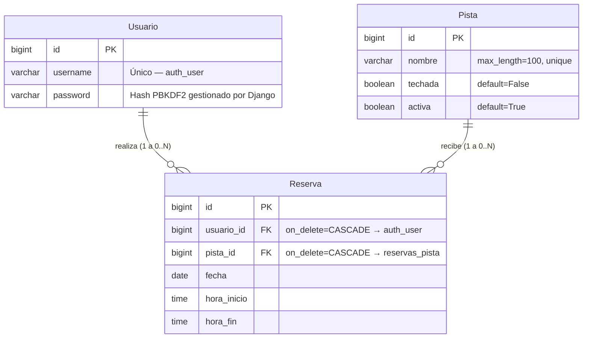

# Modelo Entidad-Relación (ER) — PadelUrban

## Nota sobre el modelo Usuario

`Usuario` es el modelo estándar de autenticación de Django (`django.contrib.auth.models.User`, tabla `auth_user`). No está definido en `reservas/models.py`. En el diagrama se representan únicamente los campos relevantes para el contexto de la aplicación (`id`, `username`, `password`). El modelo real contiene además `email`, `first_name`, `last_name`, `is_active`, `is_staff`, `date_joined` y otros, todos gestionados por Django.

## Diagrama ER (Notación de patas de gallo)

## Tablas reales en SQLite

| Clase Django | Tabla SQLite |
|---|---|
| `django.contrib.auth.User` | `auth_user` |
| `reservas.Pista` | `reservas_pista` |
| `reservas.Reserva` | `reservas_reserva` |

## Descripción de Relaciones

- **Usuario — Reserva (`1:N`, `||--o{`):** Cada `Reserva` pertenece obligatoriamente a un `Usuario` (`AUTH_USER_MODEL`). Un usuario puede tener cero o muchas reservas. La clave foránea `usuario_id` apunta a `auth_user.id` con `on_delete=models.CASCADE` (al eliminar el usuario, se eliminan sus reservas).
- **Pista — Reserva (`1:N`, `||--o{`):** Cada `Reserva` pertenece obligatoriamente a una `Pista`. Una pista puede tener cero o muchas reservas. La clave foránea `pista_id` apunta a `reservas_pista.id` con `on_delete=models.CASCADE` (al eliminar la pista, se eliminan sus reservas).

## Reglas de Negocio (Validación en `Reserva.clean()`)

1. **Hora de fin posterior al inicio:** Debe cumplirse estrictamente `hora_fin > hora_inicio`.
2. **Ausencia de solapamientos (permitiendo reservas consecutivas):** Para una misma `pista` y `fecha` (excluyendo la propia reserva en edición), no puede existir otra con `otra.hora_inicio < nueva.hora_fin` y `otra.hora_fin > nueva.hora_inicio`. Las desigualdades estrictas permiten reservas consecutivas donde un fin coincide con el inicio siguiente.

## Exportación

El diagrama Mermaid (`erDiagram`) se entrega también en [SVG](modelo_er.svg) y [PDF](modelo_er.pdf). Los tipos del diagrama son lógicos. En SQLite los identificadores son enteros y el modelo estándar de usuario de Django declara su PK como `AutoField`.

